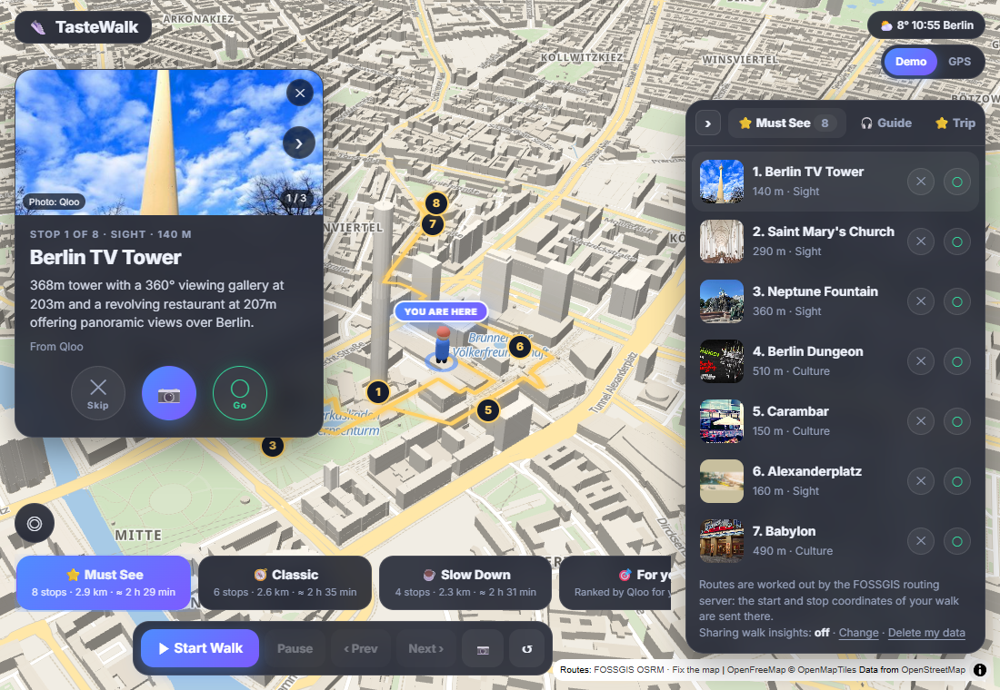
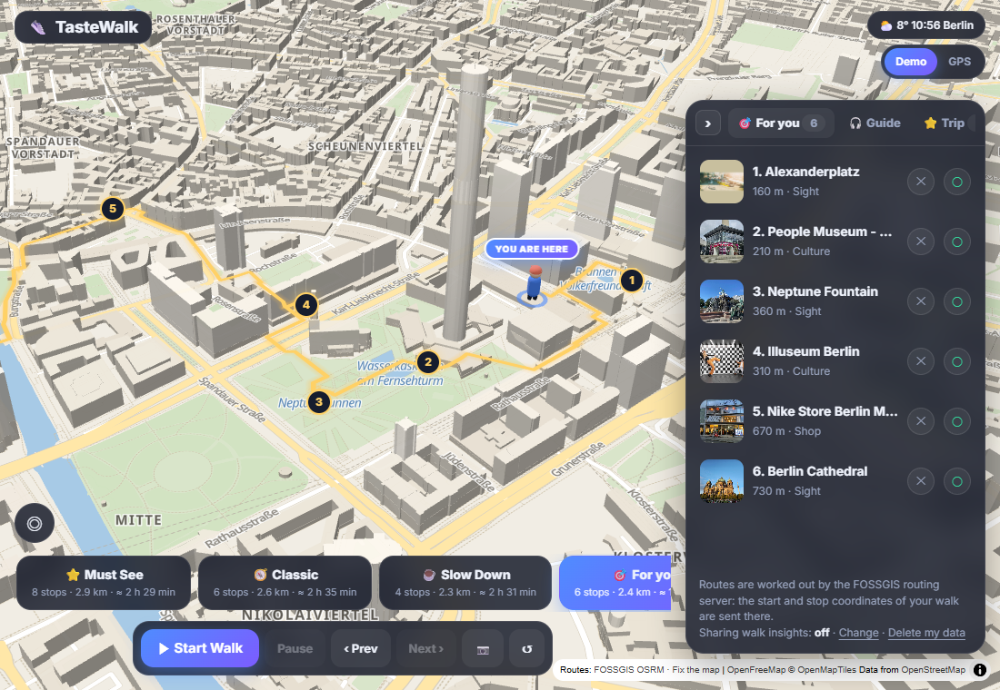
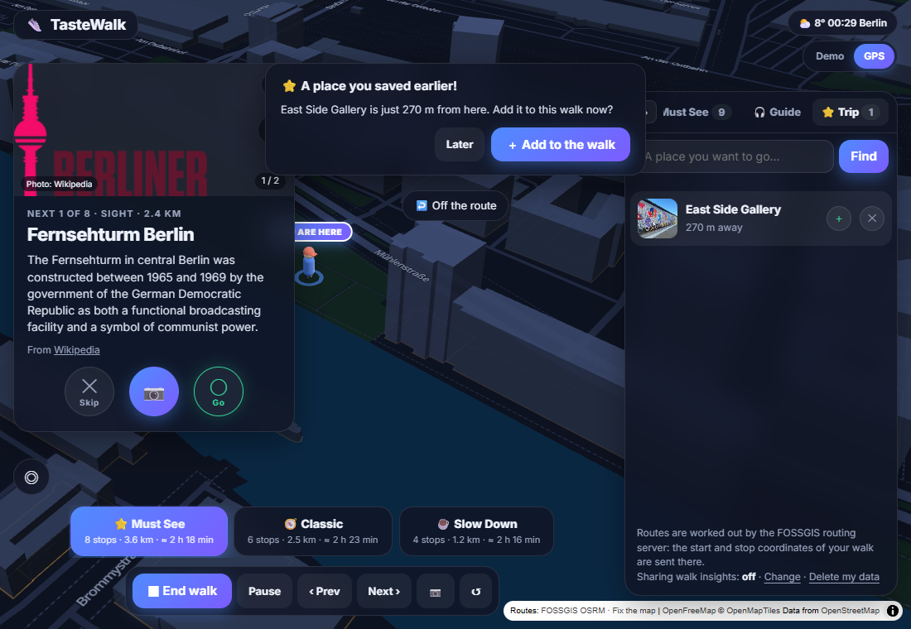

# TasteWalk Berlin

**A voice-only GPS walking guide that learns your taste as you walk — powered by the Qloo Taste AI API.**
Built for the [Qloo Agentic Hackathon](https://qloo.devpost.com/).

**Live demo:** https://tastewalk.onrender.com · **License:** MIT



## The problem

City walking guides are the same for everyone: the same ten landmarks, in the same order, read from the same script.
But two people on Alexanderplatz want different things — one wants museums, the other wants a bar with a DJ.
A good local friend would notice what you like on the way and change the plan. TasteWalk tries to be that friend:

- You walk; the guide **talks to you** (turn hints, the place you're passing, the street you're on, weather tips, photo spots).
- On each stop you tap **○ Go** or **✕ Skip**. Those taps are taste signals.
- Qloo turns them into a **"For you" walk** — the places around you that people with the same taste like most.
- Places you want but that are too far away go to your **Trip** list; when you later walk near one, the guide asks if you want to add it now.

## What Qloo does in the app (and why it fits)

All Qloo calls go through the hackathon kit's supported surface, the **`qloo api` CLI** from `@qloo/qloo-harness` 0.1.26, run by our Node server (`server/qloo.js`) — one CLI process per uncached request, never from the browser, the key never leaves the server.

| App feature | Qloo call (Insights API, `filter.type=urn:entity:place`) | Why Qloo |
|---|---|---|
| The walks (Must See / Classic / Slow Down) | places within 1.5 km of the start: `filter.location=POINT(lon lat)`, `filter.location.radius=1500`, 50 results | real places with descriptions, photos, popularity and kind-of-place tags |
| **For you** walk | the same area, plus `signal.interests.entities=<the places you said Go to>` | ranks the area by taste affinity to *your* Go's |
| "People who liked X also like Y" (after each Go) | `--signal-entities <ids>`, `--filter-location Berlin` | the taste graph, not just "nearby" |
| Passing places, weather tips, photo spots | places within 300 m of where you are | the place's own description, tags (e.g. "Late night", "Photography") and popularity |
| Trip search ("a place I want to go") | `qloo api search -t place` | find a place by name, then check the detour |

What the app sends to Qloo: place ids, a search text you typed, and a point rounded to about 100 m. No names, no device id, no location history.

## Request → result, step by step (key redacted)

1. **Plan the area.** Start = Alexanderplatz station.

   ```sh
   qloo api insights -t place -n 50 --json \
     --params '{"filter.location":"POINT(13.41112 52.52156)","filter.location.radius":1500}'
   ```

   → 50 places, sorted by Qloo popularity (Domcafé, Pergamonmuseum, Alte Nationalgalerie, Alexanderplatz, Neues Museum, …).
   The server keeps only what the app shows. It drops places whose kind is a hotel, spa, electronics store, supermarket, shopping mall, station or bare building, and it removes duplicate names.
   The app sorts the rest into kinds from Qloo's `urn:tag:category:place` / `urn:tag:genre:place` tags: culture first, then landmark, then food, then shopping. That way the TV Tower counts as a landmark, even though it has a restaurant.

2. **You walk and tap ○ Go on Berlin TV Tower.** The app remembers that place's Qloo entity id (on your device only).

3. **Tap "For you".**

   ```sh
   qloo api insights -t place -n 30 --json --signal-entities <TV Tower id> \
     --params '{"filter.location":"POINT(13.41112 52.52156)","filter.location.radius":1500}'
   ```

   → the same area, ranked by affinity. For example, with the DDR Museum as the signal: Neptune Fountain 0.968, Neues Museum 0.961, Saint Mary's Church 0.959, Egyptian Museum 0.958, …
   The app takes the top 12, picks 6 of them along a walkable route (OSRM foot routing) and says why: *"6 places Qloo ranks highest for what you said Go to."*
   Affinity is aggregate taste data — what people with this taste like — **not a prediction about you**, and the app says so next to every suggestion.



## Everything else the guide does

- **GPS walking like a local friend** (ported from my earlier Seoul guide, myeongdong-3d):
  - turn-by-turn hints;
  - "you're off the route" (more than 45 m away) and "back on the route";
  - progress pings;
  - "look to your left/right" when you arrive.
- **Robust GPS handling:**
  - a walk started in GPS mode is re-planned from where you are;
  - reaching a later stop first re-orders the rest;
  - jumpy fixes (accuracy worse than 50 m) are ignored;
  - the screen stays on during a walk (Wake Lock).
- **Street stories:** the street you're on is read from the map tiles, and the guide reads the first two sentences of its English Wikipedia article, word for word (no LLM).
- **Photo spots:** a Qloo place within 120 m that has a photo tag (Photography, Scenic, Viewing platform, …) and Qloo popularity of at least 0.9 triggers "Photo spot!".
  The 📷 button opens a post sheet with Title, Content and Tags filled in from Qloo. "Post to Instagram" uses the phone's share sheet and copies the caption. The photo never leaves your phone.
- **Trip list:** search a place → if the detour is 15 min or less it is added to today's walk, otherwise it's saved. Within 300 m of a saved place a pop-up asks: *Add it to this walk now?* — you choose.



- **Voice:** ElevenLabs. The server keeps the key, caches repeated lines and caps the public demo at a daily character budget. If ElevenLabs is unavailable, the browser's own voice reads the line.

## What changed during the hackathon

TasteWalk started from the code of my earlier project, myeongdong-3d, a Seoul walking guide whose last update was on 2026-08-01, before the submission period. That project had **no taste data at all**. Built during the submission period (Sep 30 – Oct 30, 2026):

- every place, walk and suggestion comes from Qloo (via the kit's `qloo api` CLI);
- the Go/Skip → Qloo taste loop and the **For you** walk;
- the move to Berlin and to GPS-first, voice-only guidance;
- the photo-spot and Trip features;
- a single Node server/container instead of serverless functions, as the kit requires.

## Run it yourself

Requirements: Node.js ≥ 22.19 and a Qloo hackathon API key. An ElevenLabs key is optional.

```sh
git clone https://github.com/gracelee087/qloo-walk && cd qloo-walk
npm install --global @qloo/qloo-harness@0.1.26
export QLOO_HOME="$PWD/.qloo"                      # keeps the harness config inside the project
qloo api config set base-url https://hackathon.api.qloo.com   # hackathon keys only work on this base URL
cp .env.example .env                               # put QLOO_API_KEY (and optionally ELEVENLABS_API_KEY) in it
npm run serve                                      # → http://localhost:8888
```

Or as a container (the way the live demo runs; pass the keys as secrets, never bake them into the image):

```sh
docker build -t tastewalk .
docker run -p 8080:8080 -e QLOO_API_KEY=… -e ELEVENLABS_API_KEY=… tastewalk   # → http://localhost:8080
```

Tap **Demo** to walk a simulated route from Alexanderplatz, or **GPS** to walk for real anywhere within 25 km of it.

## Known limitations — what this does not establish

- **Affinity is not a personal prediction.** It is aggregate taste data from Qloo. With one or two Go's the For you walk mostly reflects the area plus those places; we have not measured whether it matches what a given walker enjoys.
- **Speed:** each uncached Qloo call is a CLI process. On the live server (Render, 0.5 CPU) we measured 4–6 s for one call and 12–14 s each when three run at once. Cached calls take under 0.1 s. Results are cached in the server's memory only (Qloo data is never stored on disk or in this repo). If Qloo doesn't answer, walks fall back to OpenStreetMap places, and the app says so.
- **Place kinds come from Qloo's tags.** Some places land in a surprising walk (e.g. a bar tagged "Tourist attraction" in Must See).
- **Instagram:** reels inside the card would need an Instagram Business account, a Meta app and approval for the *Instagram Public Content Access* feature (Hashtag Search: max 30 hashtags per 7 days). That is not part of this submission. The card's last slide links to the place's public hashtag page instead (no API, no account, nothing sent from our side).
- **Tested** with a headless browser and GPS emulation:
  - re-planning from a GPS start, out-of-order stops, ignored jumpy fixes;
  - the Trip pop-up, the For you walk, the OpenStreetMap fallback;
  - ElevenLabs playback and the device-voice fallback.

  **Not yet tested on a real phone:** the screen staying on, iOS audio, the share sheet into Instagram.
- The guide speaks English only. Street stories only exist for streets with an English Wikipedia article.
- Guidance stops when the phone locks — a web app can't run in the background.

## Data handling

| Goes to | What | When |
|---|---|---|
| Our server → Qloo | place ids, your search text, a point rounded to ~100 m | while planning / walking |
| Our server → ElevenLabs | the text of the guide's line | each new line |
| FOSSGIS OSRM | the start and stop coordinates of the walk | when a walk is routed |
| Supabase (EU) | which places you Go/Skip, photo yes/no, minutes stayed — **only if you opt in**; no coordinates, a random id; "Delete my data" in the app | during the walk |
| Nowhere | your photos, your Trip list, your Go/Skip history (kept on your device) | — |

## Credits

- Places, descriptions, photos and taste data: [Qloo](https://www.qloo.com/) Insights API (hackathon access).
- Voice: [ElevenLabs](https://elevenlabs.io/).
- Map: [OpenFreeMap](https://openfreemap.org/), with map data © [OpenStreetMap](https://www.openstreetmap.org/copyright) contributors (ODbL).
- Walking routes: [FOSSGIS OSRM](https://routing.openstreetmap.de/).
- Street stories: [Wikipedia](https://en.wikipedia.org/) (CC BY-SA 4.0); each story links to its article.
- Weather: [Open-Meteo](https://open-meteo.com/).

The OpenStreetMap fallback places live in `data/area-pois.json`.
